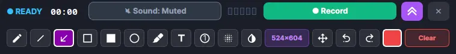
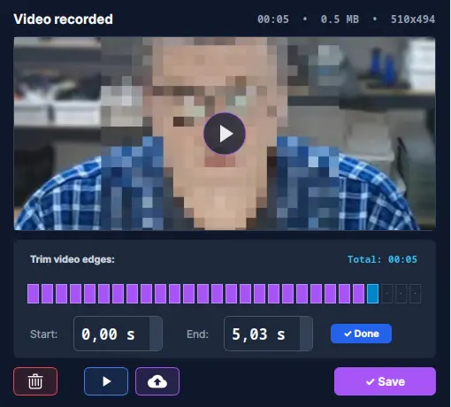

# Flameshot +

Yes, yes, this is yet another fork of a fork.

I use Flameshot on a daily basis, but was frustrated by its limitations: missing window snapping, lack of native modern WebP output, and zero video/audio recording capability. So I took the codebase starting from commit [`70be63d478a271da549597d69bd4868607c0a395`](https://github.com/flameshot-org/flameshot/commit/70be63d478a271da549597d69bd4868607c0a395) (v12.1.0 release), extended it with the missing features, optimized the build, and had a lot of fun doing it.

If you like it, you can build it, use it, and enjoy a faster, fully featured tool. If you find this project useful, feel free to star the repository and share feedback!

---

## Visual Overview

### 1. Compact Floating Recording HUD & Live Annotation Tools
<p align="center">
  
</p>

*Dedicated recording control bar with real-time hardware multi-segment audio VU-meter, live drawing suite (pencil, arrow, line, rectangle, circle, marker, text, step counter, pixelate blur, invert), audio source switcher, resolution indicator, and instant record/stop controls.*

---

### 2. Instant Stream Trimming & High-Capacity Cloud Upload
<p align="center">
  
</p>

*Interactive post-recording dialog featuring sub-second instant video trimming (lossless stream-copy without re-encoding), custom block-segmented boundary slider, built-in player launcher, and direct cloud upload up to 1 GB (Catbox / Litterbox).*

---

## What is New in Flameshot +

- **Integrated Video & Audio Recording:** Record any selected screen area or snapped window directly into high-quality MP4 (`x264` + `AAC`) with perfect A/V synchronization (`aresample=async=1000`). Videos are saved automatically to `~/Video/flameshot-plus/`.
- **Live On-Screen Drawing During Recording:** Draw and annotate directly over the video stream while recording. Full toolset includes freehand pencil, arrows, straight lines, rectangles (outline & fill), circles, semi-transparent highlighter, direct text typing, auto-increment step counter badges (1, 2, 3...), dynamic pixelation/blur, color inversion, undo/redo (`Ctrl+Z` / `Ctrl+Shift+Z`), and instant canvas wipe (`C`).
- **Hardware-Accurate Audio VU-Meter:** Multi-segment real-time VU-meter on the floating HUD providing visual volume level feedback for microphone and system audio.
- **Sub-Second Lossless Stream Trimming:** Trim video boundaries in under 0.2s using ffmpeg stream-copy (`-c copy`) without CPU-heavy re-encoding or quality degradation. Includes an intuitive block-segmented timeline slider.
- **High-Capacity Cloud Sharing (up to 1 GB):** Dual-tier cloud uploading with automatic routing: standard Catbox cloud for files up to 200 MB, and high-capacity Litterbox cloud for large recordings up to 1 GB. Features live transfer progress (MB sent / total MB / percentage) and instant clipboard link copying.
- **In-App Multi-Language Switcher (35 Languages):** Built-in language selector in General Configuration supporting English, Russian, Ukrainian, German, French, Spanish, Italian, Polish, Chinese, Japanese, and 25+ more locales with complete translation coverage.
- **EWMH Hardware-Accurate Window Snapping:** Window snapping via `_NET_CLIENT_LIST_STACKING` that detects genuine application windows with window manager frames, automatically ignoring Flameshot's own capture overlay.
- **Enhanced Uploads History:** Robust "Latest Uploads" dialog supporting both screenshots and video recordings with direct URL copying, browser launching, and safe item deletion.
- **Persistent Area Coordinates:** Selection geometry is automatically saved to `/tmp/screenink_area.env` and `/tmp/screenink_area.txt` for scripting and external tools.
- **Default WebP Format:** Ultra-lightweight screenshots saved directly in modern WebP format by default.
- **Build Optimization:** Compiled with `-O3`, `-flto=auto` (Link-Time Optimization), and linker dead-code elimination (`-Wl,--gc-sections`). Resulting stripped binary is ~**1.7 MB**.

---

## Quality Assurance & Automated Testing

All modifications are backed by automated tests integrated into GitHub Actions CI/CD to ensure stability and proper packaging.

### Codebase Changes & Packaging Details

- **Integrated Tool Shortcuts:** Properly registered all new tool identifiers (`TYPE_RECORD`) in Flameshot's shortcut table to ensure compatibility with the internal configuration validator (`config --check`).
- **Anonymous Uploading:** Replaced deprecated Imgur integration with anonymous uploads to `0x0.st` and automatic fallback to `Catbox.moe`.
- **Debian Packaging:** Built according to Debian packaging standards with `Provides: flameshot`, `Conflicts: flameshot`, and `Replaces: flameshot` for seamless package replacement. Includes `/usr/share/doc/flameshot-plus/copyright` and `postinst`/`postrm` desktop/icon cache hooks.
- **Build Hardening:** Compiled with `-flto=auto`, linker garbage collection, and non-executable stack verification (`GNU_STACK`).

### Multi-Tier Automated Test Suite (Run on Every CI Build)

Every commit and release artifact undergoes exhaustive automated verification across multiple CI stages before publication:

1. **Static Code Analysis (`cppcheck`):**
   - Independent pre-build CI gate running with `--enable=warning,performance,portability --error-exitcode=1`.
   - Mathematically verifies code against null-pointer dereferences, resource leaks, dead stores, and undefined behavior before compilation begins.
2. **Virtual Display GUI Lifecycle & Event Loop (`Xvfb` + `xdotool`):**
   - Headless automated GUI test running under a real virtual X11 server (`1920x1080x24`).
   - Spawns the graphical overlay, initializes the Qt event loop, dispatches synthetic keyboard events (`Escape`), and confirms clean session termination and memory deallocation with exit code 0.
3. **Concurrency & SingleApplication Mutex Safety:**
   - Multi-process race-condition testing verifying that concurrent invocations gracefully lock, transfer focus, and prevent configuration/file corruption.
4. **Fault Injection & Malformed Geometry Protection:**
   - Injects degenerate and invalid capture regions (e.g., `0x0+0+0`, out-of-bounds offsets) to verify that exception handlers reject invalid inputs without segmentation faults.
5. **Configuration & Shortcut Semantic Integrity:**
   - Executes automated `config --check` verifying zero unrecognized keys, zero semantic errors, and full shortcut hash table integrity.
6. **ELF Binary Security & Hardening:**
   - Inspects ELF headers to enforce non-executable stack permissions (`GNU_STACK` RW, no X).
   - Enforces strict size budget (< 3.0 MB) after LTO and `sstrip` section pruning.
7. **CLI Interface Contract:**
   - Validates command-line flags, rebrand integrity, and exit status contracts.
8. **Storage & Recording Pipeline:**
   - Verifies runtime paths (`~/Video/flameshot-plus/`) and environment coordinate contracts (`/tmp/screenink_area.env`).
9. **Screen Capture & WebP Encoding Pipeline:**
   - Validates native headless WebP generation, compression validity, and image header integrity.
10. **Debian Package Policy Compliance:**
    - Deep structural audit of the `.deb` package (`dpkg -I`, `dpkg -c`), checking package replacement directives (`Provides/Conflicts/Replaces: flameshot`), embedded GPLv3 copyright documentation, and `postinst`/`postrm` cache hooks.

---

## Installation & Download

### Debian 12 / Ubuntu (.deb)

Pre-built packages are automatically built on Debian 12 via GitHub Actions:
1. Download `flameshot-plus_12.1.0-1_amd64.deb` from [Release v12.1.0-plus](https://github.com/Svarkovsky/flameshot-plus/releases/tag/v12.1.0-plus).
2. Install via apt:
```bash
wget https://github.com/Svarkovsky/flameshot-plus/releases/download/v12.1.0-plus/flameshot-plus_12.1.0-1_amd64.deb
sudo apt install ./flameshot-plus_12.1.0-1_amd64.deb
```

Or download the standalone binary:
```bash
wget https://github.com/Svarkovsky/flameshot-plus/releases/download/v12.1.0-plus/flameshot-plus
chmod +x ./flameshot-plus
./flameshot-plus gui
```

---

## Quick Build & Run

### Prerequisites (Debian / Ubuntu)

```bash
sudo apt-get install build-essential cmake qtbase5-dev libqt5svg5-dev qttools5-dev-tools libx11-dev ffmpeg
```

### Build

```bash
cmake -B build -S . \
  -DCMAKE_BUILD_TYPE=Release \
  -DENABLE_IPO=ON

cmake --build build -j$(nproc)
```

### Run

```bash
./build/src/flameshot gui
```

### Shortcuts

- `W` or `Tab`: Snap selection to window under cursor (EWMH)
- Double Click: Snap selection to clicked window
- `Esc` or `Q`: Stop active recording / close overlay
- `Space` or `Enter`: Start recording when in ready mode
- `C`: Clear all live drawings from recording canvas
- `Ctrl + Z`: Undo last drawing action
- `Ctrl + Shift + Z`: Redo last drawing action

---

## Disclaimer & Upstream Authorship

All original rights, intellectual property, and authorship belong entirely to the original authors and contributors of Flameshot at [https://github.com/flameshot-org/flameshot](https://github.com/flameshot-org/flameshot).

This repository is an independent personal fork created solely for personal convenience. All upstream questions, feature requests, and bug reports regarding the base Flameshot application should be directed to the official project at [https://github.com/flameshot-org/flameshot](https://github.com/flameshot-org/flameshot).

The author of this fork accepts absolutely NO responsibility, liability, or warranty of any kind. I am not responsible for anything; use this software strictly at your own risk.

---

## Fork Author & Maintainer

- **Author & Maintainer:** Ivan Svarkovsky ([@Svarkovsky](https://github.com/Svarkovsky))
- **Repository:** [https://github.com/Svarkovsky/flameshot-plus](https://github.com/Svarkovsky/flameshot-plus)
